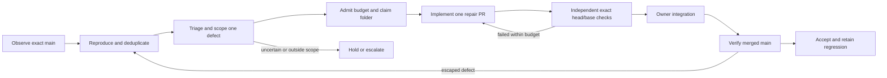

# Jules pipeline and product audit — 2026-10-24

**Historical checkpoint:** findings and implementation states below describe the revisions named here. Subsequent repairs are documented in [Factory operations](FACTORY-OPERATIONS.md); this retained audit is not the current deployment record.

## Decision

The candidate is a safer, bounded game-generation controller. It is **not yet a qualified autonomous post-merge maintenance system**. Better prompts alone cannot close missing lifecycle transitions, overlapping provider repair channels, stale integration, or inadequate behavioral acceptance. Prior green tests did not cover the defects reproduced in this audit.

Preserve the pinned controller, durable intents, complete account inventory, scope restrictions and independent gate. Repair the demonstrated defects, then qualify one maintenance assignment with a single repair owner. Do not expand throughput or introduce another recurring AI loop to compensate for missing reconciliation.

This audit includes concrete local repairs, described in the companion qualification receipt. It does not activate the candidate, change account settings, create Jules sessions, push or merge remote branches, or establish production acceptance. The maintenance cycle below and its prompt template are a design contract, not an implemented dispatcher feature.

## Define and measure

Initial audited source: `6c9e25f321ad0ab0ffa79c67ae0bd852200c29a8`, branch `codex/repair-jules-pipeline-20261024`. Three independent partitions inspected provider guidance, controller failure paths, and UX acceptance. The integrator reviewed the changes and retained falsification evidence. During repair, incoming main through `0b14fff` was reconciled locally at `dd24a78`, preserving game084 phase5 bosses and game085 phase3 environments while retaining prior input/cooldown repairs. Later remote activity is outside that integration checkpoint.

Final remote readback reached `fed9c5bf53fb1474a19b90c02e2ae23ba8503276` (registry rebuild after PR393, commit time 19:27:53Z): four further commits changed 084, added game086 and regenerated registry. Those later changes are **not integrated or qualified by this candidate**. The live factory continued publishing during the isolated audit. Refresh/reconcile and rerun affected acceptance before publication; the 85-game candidate results do not cover the new game086.

The earlier five-day census covers **2026-10-19 17:13:01Z through 2026-10-24 17:13:01Z**, not a moving real-time total:

| Observed record | Result | Interpretation boundary |
|---|---:|---|
| PRs created / merged | 384 / 372 | Throughput, not accepted customer outcomes |
| Formal GitHub review submissions | 0 | Does not establish absence of offline review |
| Median PR creation-to-merge interval | 21 seconds | Excludes earlier generation time |
| Main commits / registry rebuild commits | 751 / 371 | Redundant post-merge generation added substantial change traffic |
| Actions outcomes | 381 success, 19 failure, 1 cancelled | Passing checks did not test complete player journeys |

Current-turn observations: remote main still contained the older dispatcher; the installed unit still fetched/reset main before each run. The timer was active/waiting at its readback, last triggered at 15:07 EDT with 15:22 EDT next due. This is a timestamped observation, not a guarantee of later state. The candidate's account budget caps remain unset. Provider account entitlement, Reactive Mode, native CI repair behavior, repository memory and current VM configuration were not inspected. No paid provider operation was used for this audit.

Evidence states used here:

- **Observed:** source, GitHub API responses, host readback and captured test output.
- **Confirmed defect:** isolated reproduction or a direct deterministic source contradiction. Local source repair still needs separate integration/provider qualification.
- **Documented capability:** a current official page describes behavior; account availability is unverified.
- **Proposed:** an architecture or acceptance rule that is not connected to autonomous execution.
- **Unknown:** provider settings, billing semantics, physical device behavior and production acceptance.

No monetary savings, token prices, defect prevalence estimates or numerical confidence intervals are inferred from this sample.

## Analyze: controller findings

Line references below describe the initial audited revision; repairs move them. Reproduction evidence retains that revision.

| ID / severity | Demonstrated failure | Consequence and disposition |
|---|---|---|
| C1 / P1 | `factory_dispatch.py:362-367` required a matching `run.pull_requests` entry. Actual failed `pull_request_target` runs 40096948488, 40093637525 and 40087929598 returned an empty array. Existing tests manufactured a populated array. | Legitimate repair feedback was rejected. Local repair requires independent run, exact-head bot status, trusted reporting job and PR/head artifact attestations when the array is empty; conflicting nonempty associations remain rejected. |
| C2 / P1 | Active provider session plus merged PR set `terminal_record_provider_active`, then the merged branch at 482-485 removed it. Capacity passed with no local assignment. | Another task could claim the same game while prior work remained active. Local repair retains scope ownership until provider termination is reconciled. Account-wide activity was already counted; the defect concerned game ownership. |
| C3 / P2 | A provisional `failed:no_pr` outcome caused later completed-session PR outputs to be skipped at 460-461. | Paid output could become invisible and be replaced. Local repair reconsiders changed outputs and uses bounded historical reconciliation for reopened/late work, retaining outcome history. |
| C4 / P2 | A repair intent became `pending`; a new local pause then stopped the POST. Deduplication permanently consumed the attempt despite no transport being attempted. | A known-unsent repair could not resume. Local repair distinguishes not-attempted admission holds from uncertain delivery; ambiguous requests still cannot be blindly retried. |
| C5 / P1, missing capability | Three ticks with merged terminal work and failed main created neither repair session nor message. `pick_brief.py` selects new/advance/hold; merged work is terminal. | There is no post-merge defect intake or maintenance dispatcher. A maintenance path guard is permission to validate a scoped change, not a task scheduler. Design specified below; unimplemented. |
| C6 / P1, missing capability | A stale/conflicting PR with historical green checks repeatedly becomes `passed_waiting_merge`. Integration correctly rejects stale ancestry but has no convergence queue. | WIP can remain occupied indefinitely. Need explicit rebase/retest/review or superseded disposition; never force-merge or discard work. Unimplemented. |
| C7 / P1, documented risk | Provider CI Fixer and PR-comment reactions coexist with custom API repair messages. | One local message does not mean one provider attempt. Actual duplicate work was not observed. Qualify settings and assign one owner before using custom feedback in production. |
| C8 / P2, acceptance boundary | One allowed game folder is checked, but the workflow does not bind that folder to the controller's durable assignment. `tests/` changes are outside the game lane. | Scope safety is stronger than assignment correctness. A trusted reviewer must bind task ID/folder/scenarios and own regression expectations; do not widen game authority to edit its own gate. |

Cross-review also found two defects in the first repair draft: held-key autorepeat could undo pause clearing, and bounded historical polling could leave a reopened PR unobserved while its game was reassigned. These received further regressions and repairs before qualification. The latter needs a prospective-game pre-create recheck, not an unbounded scan of every old PR on each tick. Provider/GitHub state can still change after an observation; no cross-service atomic reservation is claimed.

The tentative suspicion that REST workflow `head_sha` necessarily referred to the base was **falsified and discarded**: observed records used the PR head. Do not weaken validation to accommodate an unsupported theory.

The existing process lock and observed account inventory are not a distributed reservation shared with manual tasks, schedules or other controllers. Preserve reserves and immediate admission checks, but do not call them a hard account-wide spend cap.

The current phase/maintenance PR lane runs static checks and changed-game browser smoke; the full Python/Node regression suites run in the main/infrastructure lanes. Thus adding a regression file does not automatically make it pre-merge game acceptance. Wire trusted behavioral expectations into a sandboxed browser/isolated test path before relying on them for autonomous integration. Do not simply execute arbitrary PR game JavaScript inside Node's `vm` and call that a security sandbox; the current browser boundary deliberately keeps candidate code out of the trusted Node driver.

## Analyze: usability and input findings

The sampled games were 080, 082, 083, 084 and 085 plus the launcher. This is a targeted sample, not a complete accessibility or game-quality audit of all 85 games.

| ID / severity | Confirmed behavior at audited source | Disposition |
|---|---|---|
| U1 / P1 | 084 touch could start the game but could not move the player: movement read `mouse.down`, which touch never set. | Local repair and gameplay-effect regression. |
| U2 / P1 | 083 advertised O-options shortcut stayed on TITLE because input edges were consumed before UI processing. | Local repair moves the input snapshot after all frame consumers. |
| U3 / P1 | 083 duplicate touch-control methods left virtual movement held after release; cancellation was absent. | Local repair separates physical and virtual inputs and clears release/cancel/blur/hidden states. |
| U4 / P1 | 084/085 paused on blur but only Escape resumed; touch-only users were stranded after app switching. | Local recovery controls and fresh-action regressions; physical device qualification remains open. |
| U5 / P2 | 083 import accepted Base64 JSON `null`, persisted it and crashed on `highestWave`. 080/082 only weakly checked `options`. | 083 shape/range validation and transactional replacement repaired locally. 080/082 need separate save-compatibility repairs. |
| U6 / P2 | Launcher restore accepted arbitrary strings under save-key prefixes, swallowed individual write failures and could report success after a partial restore. | Separate launcher assignment: preview/validate, preserve old values, apply with recovery record, report per-save outcomes. Unrepaired. |

Additional backlog: 080 cannot combine its separately drawn movement/action touch controls; 080 settings are pointer-only canvas targets; 083 settings remain keyboard-driven; 084/085 secondary abilities need complete touch coverage; 082 clipboard export lacks a failure fallback; launcher modal lacks focus entry/restore, Escape handling, a labelled textarea and status announcement. Zoom is disabled in the five sampled games. These are not cosmetic polish requests: they affect whether users can reach and recover core functions.

The first real Chromium journey also exposed a separate 083 direction conflict: a right D-pad input was active, but unconditional pointer steering moved the player toward the pad. An assertion about actual player direction caught what a key-presence assertion missed. The failed browser receipt is retained; virtual controls must take precedence over direct pointer steering.

Existing browser smoke establishes title/start/short PLAYING observation and absence of captured errors. It sends synthetic D/Space events without asserting gameplay effects, and its observer RAF count is not the game's loop count. Static markers such as `touchstart`, `PAUSED` or `ResizeObserver` show code presence, not working behavior. Previously passing 14 gameplay and 9 input regressions did not cover 083/084. Neither screenshots nor an agent's narrative close those gaps.

## Current Jules capabilities and prompt implications

Official sources were retrieved on 2026-10-24. The latest visible changelog entry was March 9, 2026; this is the public documentation observed, not a statement that every account has every feature.

| Capability / source | Engineering implication |
|---|---|
| [CI Fixer, February 2026](https://jules.google/docs/changelog/2026-02-19) | Jules documents detecting failed GitHub Actions on its PRs and submitting repair commits. Observe native activity before sending a custom repair; invalidate acceptance on every new head. This does not document arbitrary post-merge production repair. |
| [PR feedback and Reactive Mode](https://jules.google/docs/changelog/2025-09-23) | A comment can be a mutation channel. Verify whether reporter comments trigger native work; use one feedback channel. Reactive Mode is a global setting, so changing it has cross-repository effects. |
| [Scoped task guidance](https://jules.google/docs/running-tasks/) | Provide one observable outcome, exact folder, reproduction, invariants and stop conditions. “Improve everything professionally” is not an acceptance contract. The `jules` issue label starts work; do not use it merely to organize an unauthorised backlog. |
| [Browser verification](https://jules.google/docs/changelog/2025-08-07) | Playwright/screenshots are documented. Ask for normal input paths, actual gameplay effects, viewport and tool versions. Provider media are supporting evidence, not independent acceptance. |
| [Environment snapshots](https://jules.google/docs/environment/) and [FAQ](https://jules.google/docs/faq/) | Qualify a short setup smoke, record actual versions and reuse setup snapshots. Do not leave a development server running in setup. Published example versions do not prove the live VM. |
| [Repository memory](https://jules.google/docs/changelog/2025-09-30) | Old code-volume or auto-approval habits may survive source edits. Inspect actual repository Knowledge settings and qualify a task against the new contract. Do not assume changing AGENTS clears memory. |
| [Sessions](https://jules.google/docs/api/reference/sessions/) and [API types](https://jules.google/docs/api/reference/types/) | Starting branch is not an exact checkout-SHA guarantee. Record actual checkout and patch base. A message response is delivery evidence, not completion. No documented create-idempotency contract was found. Preserve ambiguous intents. |
| [Plan workflow](https://jules.google/docs/review-plan/) | Setup/cloning occur before plan approval. A plan-review setting is not a zero-execution boundary. Use the actual API approval contract and risk of the bounded assignment. |
| [Activities](https://jules.google/docs/api/reference/activities/) | Stable activity IDs, pagination and a documented createTime filter support compact incremental evidence. Qualify filter boundaries and retain a full-pagination fallback; do not silently truncate inventory. |
| [Planning Critic](https://jules.google/docs/changelog/2026-01-26-1) | A native review capability can improve plans; the vendor's reported aggregate improvement is not a TrashArcade acceptance result. |
| [Suggested tasks](https://jules.google/docs/suggested-tasks/) and [performance suggestions](https://jules.google/docs/changelog/2026-01-26-3) | Optional intake signals, not an additional independent dispatcher. Deduplicate against the same incident/task record and require observable benefit. |
| [Scheduled tasks guide](https://jules.google/docs/scheduled-tasks/) vs [January update](https://jules.google/docs/changelog/2026-01-26-5) | The guide says editing is unavailable; the later release note says edit/pause/resume exist. Prefer dated release evidence, then verify the current client. Do not build workarounds from stale prose. |
| [Usage limits](https://jules.google/docs/usage-limits/) | Published limits do not establish this account's entitlement, remaining capacity, follow-up charging, failed-task refunds or token-based billing. Obtain account evidence before spend claims. |

Phase9 currently bundles audio, motion, palettes, particles, FPS, handedness, touch, save transfer/reset and six badges (`factory/axes.json:123-160`). Phase10 asks for broad edge-case/memory cleanup. Split those into named user outcomes with cumulative acceptance before phase advancement. A new prompt cannot make that phase ledger exist; this remains a design change.

## Improve: the proposed maintenance management cycle

This is **not wired into `factory_dispatch.py`**. Implement it as an extension of one authoritative controller, not multiple recurring agents.

1. **Observe cheaply.** Deterministic main checks and user reports produce immutable evidence with source SHA, scenario, expected/actual behavior and artifact hashes. A red check is a signal; classify infrastructure failure, flaky test, content regression and unknown separately. Retry read-only observation with a bounded policy; do not pay an agent repeatedly to diagnose unchanged infrastructure.
2. **Reproduce and deduplicate.** Stable incident ID plus game, scenario and failure signature; keep first-seen and last-seen revisions. Different failing revisions may belong to the same incident. Record a legitimate NOT_REPRODUCED outcome; no speculative refactor is required to consume a session.
3. **Admit one owner.** Claim a game until both provider work and PR disposition are reconciled. Check actual account inventory, review capacity, budget and ambiguity holds. Define native CI repair versus controller messaging ownership per PR. Native settings/cancellation must be qualified before claiming an enforceable total attempt cap.
4. **Create the right task.** Repair an existing eligible open-PR session only when scope and current head match. A diagnosed merged defect needs a new maintenance session from current source; it must preserve phase. Do not resume a terminal session blindly. Read-only audit, game repair, UX improvement, phase progression and infrastructure work are distinct job types.
5. **Allow bounded repair of red main.** Normal generation stays blocked. A maintenance admission may refer to an owner-approved defect on failing main while the controller and validation code remain on a separately approved revision. This exception must be implemented and tested explicitly, never by bypassing `main_acceptance()` globally.
6. **Independently verify and integrate.** Require exact task/folder binding, original repro, neighboring regressions and correct current base. If main moves, rebase/reconcile without discarding work, regenerate registry, and retest. Preserve an explicit stale/conflict disposition. Game tasks cannot modify trusted tooling or tests; a trusted reviewer adds or approves regression expectations separately.
7. **Close after main acceptance.** PR merge is intermediate. Record merged SHA, new main results, scenario receipt and any device checks. A failed observation reopens the same incident. Deployment, physical-device acceptance and release remain separate records.
8. **Learn from failure.** Each escaped defect adds a minimal regression, updates the relevant task acceptance contract and records why earlier checks missed it. Remove obsolete duplicate checks once replacement coverage is demonstrated. This is the concrete mechanism for improving under stress.

Minimum task record: task/incident IDs; type; repo/folder; observed/main/controller revisions; phase; evidence/reproduction hashes; allowed paths; protected behavior; acceptance scenario IDs and expectation owner; repair owner/channel; session/PR IDs; budget and expiry; state/outcome history; actual checkout/tested/base/merged SHAs; uncertain delivery records; device/release status. Provider terminal status and product acceptance must remain separate fields.

Recommended pilot: one diagnosed 084 input journey or 083 options/input issue after deploying independently reviewed controller repairs. Those specific defects are now locally repaired, so **do not launch duplicate Jules work for them**; use their regression artifacts as qualification fixtures, or select the next still-open defect from the backlog. See [maintenance prompt](../.github/JULES_MAINTENANCE_PROMPT.md).

## Control: professional UI and input acceptance

Use one measured journey per task, preserving each game's identity. A shared launcher/input overhaul needs a separate reviewed infrastructure assignment; a game folder grant cannot authorize it.

| Surface | Required observable result |
|---|---|
| First use | User can discover controls and complete the signature mechanic without inspecting code. Instructions match implemented controls. |
| Core journey | Title → start → movement/action → pause → resume → loss/retry → Back; run through every declared input mode. Assertions inspect effects, not merely event delivery. |
| Input recovery | Release/cancel/blur/visibility loss clears held actions. Resuming requires a fresh action and preserves run state without firing or moving unintentionally. |
| Layout | Portrait, landscape and desktop; actual hit boxes align after resize/orientation; menus remain readable and controls do not cover required play areas. |
| Settings | Reachable controls, visible focus, meaningful labels and truthful status. Audio, motion and palette controls change the intended behavior. |
| Saves | Shape/range/version validation, compatible migration, invalid import rejection, retained prior save, explicit storage/clipboard failure and recovery. Never announce a partial restore as complete success. |
| Evidence | Tested SHA, browser/tool version, viewport, action sequence, expected/actual state, console errors and relevant screenshots. Emulated touch, actual hardware and audible output have separate results. |

Use WCAG2.2 as an engineering reference, not a certification claim. [Keyboard access](https://www.w3.org/WAI/WCAG22/Understanding/keyboard.html) applies with its essential path-dependent-input exception. [Target Size Minimum](https://www.w3.org/WAI/WCAG22/Understanding/target-size-minimum.html) specifies 24 CSS pixels or its stated exceptions; a 44px project target is a design preference, not the AA minimum. [Pointer cancellation](https://www.w3.org/WAI/WCAG22/Understanding/pointer-cancellation.html) matters for menus; essential gameplay down-events need separate judgment. Test focus, zoom, contrast, reduced motion and assistive-technology interaction before broader accessibility claims.

## Efficiency, tradeoffs and falsification

Prefer subtraction: remove duplicate repair channels, redundant registry commits, generic nudges, oversized prompts and repeated full-repository context. Reuse a qualified environment. Send bounded exact failure evidence plus links/hashes. Cache activity records by ID and page completely when needed. Admit an AI session only for a novel diagnosed defect or approved improvement with measurable acceptance.

Measure **accepted repairs per created session**, first-pass scenario acceptance, escaped/reopened defects, repair commits/messages per accepted change, setup time, stale-WIP age and owner review time. Track all native/manual/scheduled work in capacity. Prompt bytes/tokens are diagnostics; credit savings require billing evidence. No universal quota percentage or maximum parallelism is recommended without the actual entitlement and review capacity.

| Lens | Benefit | Cost / boundary |
|---|---|---|
| Engineering | Smaller tasks, explicit state transitions and preserved identity | A maintenance ledger and assignment attestation must be implemented |
| Quality | Reproduced failures become independently owned regressions | Smoke remains useful but cannot replace behavior tests |
| Operations | Durable ambiguity, bounded reconciliation and stale-WIP dispositions | No claim of autonomous recovery until a live cohort is qualified |
| Security | Game code cannot edit its own controller or acceptance machinery | Native comments/memory and provider settings are additional channels to qualify |
| End user | Reachable controls, recovery, honest saves and complete journeys | Device ergonomics and design judgment require user/device evidence |
| Financial | Fewer duplicate sessions and repeated failures | Actual savings unknown until acceptance and account consumption are measured |

| Hypothesis | Supporting / contradicting evidence | Confidence and falsifier |
|---|---|---|
| Missing control/acceptance transitions dominate the observed failures | Four controller reproductions and five UX probes support it; no complete provider cohort was tested | High for the demonstrated paths, unknown for portfolio prevalence. A qualified end-to-end maintenance run would narrow the missing-capability claim. |
| Longer or more forceful prompts are the main remedy | Explicit existing prompts still yielded inaccessible controls; broad phases create ambiguous completion | Low. A measured controlled task cohort could show prompt changes improve acceptance, but cannot remove code-level lifecycle defects. |
| Native CI Fixer alone supplies post-merge self-repair | Official promise concerns Jules PR CI, not arbitrary merged incidents; no queue exists locally | Unsupported for this repository. Current account evidence demonstrating that full lifecycle would change the conclusion. |
| Maximum concurrency improves value | High merge throughput coexists with escaped defects and zero formal reviews in the census | Unsupported. Increase WIP only when accepted throughput improves without more escapes, stale work or review overload. |

Stop new dispatch if a duplicate repair launches, provider commits continue after an assumed stop, acceptance names a stale head/base, a task crosses its game boundary, an ambiguous mutation is retried, or a known regression escapes. Retain evidence and repair the violated control before resuming. A local pause proves only that this controller stopped issuing requests; it does not prove remote work stopped.

## Outstanding work and evidence

Still required: native repair/settings qualification; maintenance intake/admission/closure; stale-PR convergence; assignment-bound acceptance; trusted behavioral regression ownership; remaining launcher/save/touch backlog; physical-device, audio and customer acceptance. These are explicit open items, not implied accomplishments.

Raw evidence is retained under `$HOME/Documents/Codex/2026-10-24/LFS-TrashArcade-Adversarial-Audit/`; earlier census and qualification records remain in adjacent Review and Repair folders. The companion `ADVERSARIAL-QUALIFICATION-2026-10-24.md` records final local test counts, revision and limits. Failed baseline tests and infrastructure-limited attempts remain part of the evidence.
